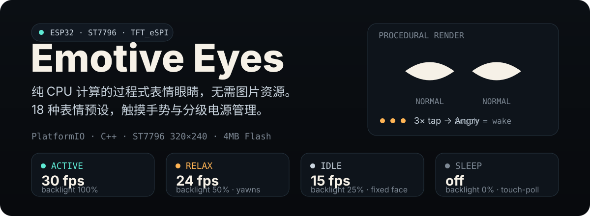

# ESP32 Emotive Eyes

> **固件版本 2.0.0** · 验证硬件：HW-950 / ESP32-2432S024R

  

Emotive Eyes 是一套运行在 ESP32-2432S024R 上的过程式表情眼睛固件。它用代码生成眼睛轮廓和动画，并直接绘制到 ST7796 触摸屏，不需要预制眼睛图片或动画帧素材。

## 2.0.0 的实现亮点

- **程序生成表情**：提供 19 种表情预设；眼睛几何、视线、微表情和眨眼由同一套动画管线组合，表情切换使用 500ms Smoothstep 插值。
- **平滑轮廓渲染**：曲线轮廓由圆角多边形生成，以 8 点覆盖率采样减轻边缘锯齿；凸多边形使用双边链扫描线，特殊轮廓保留通用扫描路径。
- **适配 ESP32 内存**：优先使用 320×240 全屏 Sprite；申请失败时用一块 160×240 缓冲分两次绘制，再失败则切换为直接绘制到 TFT。
- **减少无效传输**：只更新变化区域；表情静止时不重复推送画面。
- **自然眼神行为**：微小漂移和快速扫视使用不同速度与幅度，节奏随表情变化；眨眼或表情切换期间不会插入新的眼神动作。

本版的显示结果包括更平滑的眼睛边缘、更大的 Normal 眼型、表情相关的自然眼神变化，以及下滑后立即开始的柔和渐暗。睡眠画面保留闭眼与月牙星光，背景使用淡暖白。

Normal 眼型为 60×60 像素。基础眼尺寸为 70，`EyeInterDistance=15`；按当前几何，两眼中心距为 100 像素，Normal 轮廓间约留 40 像素。

## 固件配置

三个构建环境共用表情和渲染实现。帧间隔表示软件调度目标，不是面板的物理刷新率。

| PlatformIO 环境 | 用途 | 程序帧间隔 | CPU 频率 | 空闲行为 |
|---|---|---|---|---|
| `esp32dev_always_on` | 默认常亮固件 | 16ms，约 60fps 目标 | ACTIVE 80MHz | 不按空闲时间自动变暗或熄屏 |
| `esp32dev_battery` | 电池省电固件 | ACTIVE 16ms、RELAX 22ms、IDLE 33ms | ACTIVE/RELAX 80MHz、IDLE 40MHz、SLEEP 80MHz | 60秒进入 RELAX、3分钟进入 IDLE、5分钟进入 SLEEP |
| `esp32dev_expression_test` | 循环表情与性能观察 | 16ms，约 60fps 目标 | 240MHz | 每 450ms 切换表情并输出调试日志 |

16ms 的程序间隔理论上对应每秒最多 62.5 次循环。历史短时日志和测量边界见[验证记录](docs/verification/README.md)。

## 构建与烧录

安装 [PlatformIO](https://platformio.org/)（VS Code 扩展或 CLI），连接目标板后：

~~~bash
pio run
pio device list
pio run -t upload --upload-port YOUR_PORT
~~~

`pio run` 默认构建常亮固件。将 `YOUR_PORT` 替换为设备串口，例如 Windows 下的 `COM7`。烧录省电版或表情测试版时指定环境：

~~~bash
pio run -e esp32dev_battery -t upload --upload-port YOUR_PORT
pio run -e esp32dev_expression_test -t upload --upload-port YOUR_PORT
~~~

本地验证包括三个固件环境构建通过，以及 Native 主机测试 13/13 通过。只有表情测试固件默认输出性能日志；串口速率为 115200 baud。

## 交互与电源行为

| 操作 | 结果 |
|---|---|
| 单击 | 快速眨眼反馈 |
| 双击 | 回到 Normal |
| 三连击 | 触发 Angry |
| 长按 2 秒 | 回到 Normal |
| 上滑 | Coquette；700ms 内再次上滑触发 Glee → Awe → Happy |
| 左滑 / 右滑 | 亮度每次降低 / 提高 10%，范围 20–100%，设置保存到 NVS |
| 下滑 | 显示 Sleepy 与月牙星光，并从当前亮度立即平滑渐暗至 IDLE 档；再次触摸唤醒 |
| BOOT 长按约 1 秒后松开 | 进入软件 `SOFT_OFF` 深睡；使用 RST/EN 重新启动 |

省电状态机只在 `esp32dev_battery` 中按空闲时间自动运行。RELAX 和 IDLE 的背光目标分别为用户亮度的 50% 和 25%（最低 20%）；SLEEP 关闭背光并停止绘制，以 50ms 间隔检查触摸。芯片温度达到 70°C 时，ACTIVE/RELAX 降至 IDLE；达到 80°C 时进入 SLEEP，降至 65°C 后解除保护。

`SOFT_OFF` 会关闭屏幕和背光并让 ESP32 进入 Deep Sleep，但不会切断电池。Deep Sleep 没有按键唤醒源，需通过 RST/EN 重启；长期断电请使用板载电池开关 SW1。当前没有电池电压、整机电流或续航实测，详见[电池供电诊断](docs/电池供电诊断.md)。

## 硬件

| 部件 | 配置 |
|---|---|
| 主控 | HW-950 / ESP32-2432S024R，ESP32-WROOM-32 |
| 显示 | ST7796 SPI TFT，逻辑分辨率 320×240 |
| 触摸 | XPT2046，与 TFT 共用 SPI 总线 |
| SPI 时钟 | TFT 80MHz，触摸 2.5MHz |
| 背光 | GPIO27 |

板级引脚和接线见[引脚参考手册](docs/ESP32-WROOM-32_引脚参考手册.md)及[引脚功能图解](docs/ESP32-WROOM-32_引脚功能图解.md)。STEP/STL 外壳资料位于 [`case/`](case/)。

## 文档

- [文档导航](docs/README.md)
- [技术文档](docs/技术文档.md)
- [电池供电诊断](docs/电池供电诊断.md)
- [历史性能与状态验证记录](docs/verification/README.md)
- [版本变更记录](CHANGELOG.md)

## 限制

- 当前没有经过验证的电池电压采样通路，固件不报告电量或充电状态。
- 帧率来自固件循环与绘制计时，不代表屏幕面板的物理刷新率，也不构成长时间稳定性或电流测试。
- GPIO34 光敏输入未用于自动亮度调节；Light Sleep 默认关闭。

## 许可与来源

本项目由 playfultechnology 的 ESP32 OLED Emotive Eyes 移植并改造。上游项目由 Alastair Aitchison 发布，遵循 MIT 许可；本仓库遵循 GPL-3.0，详见 [`LICENSE`](LICENSE)。
